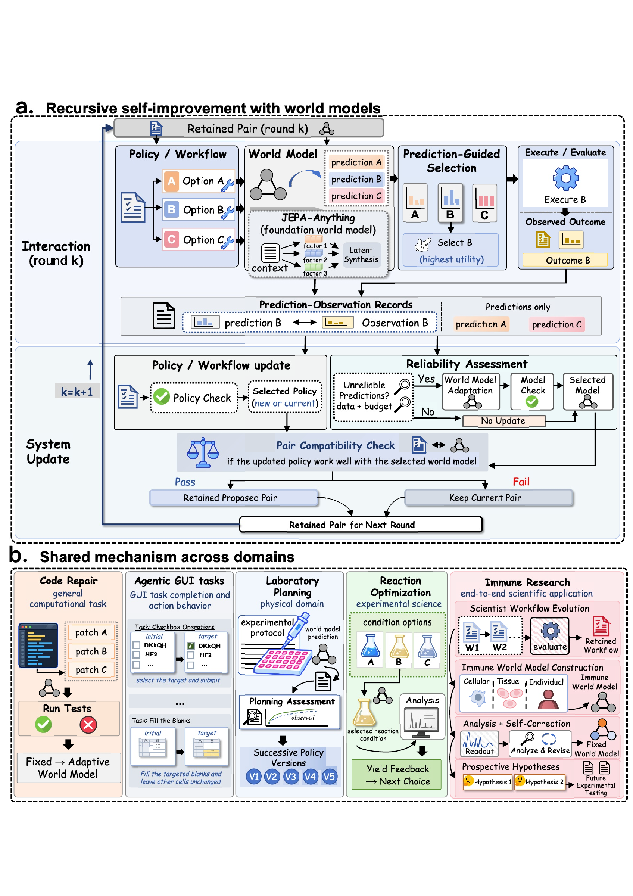
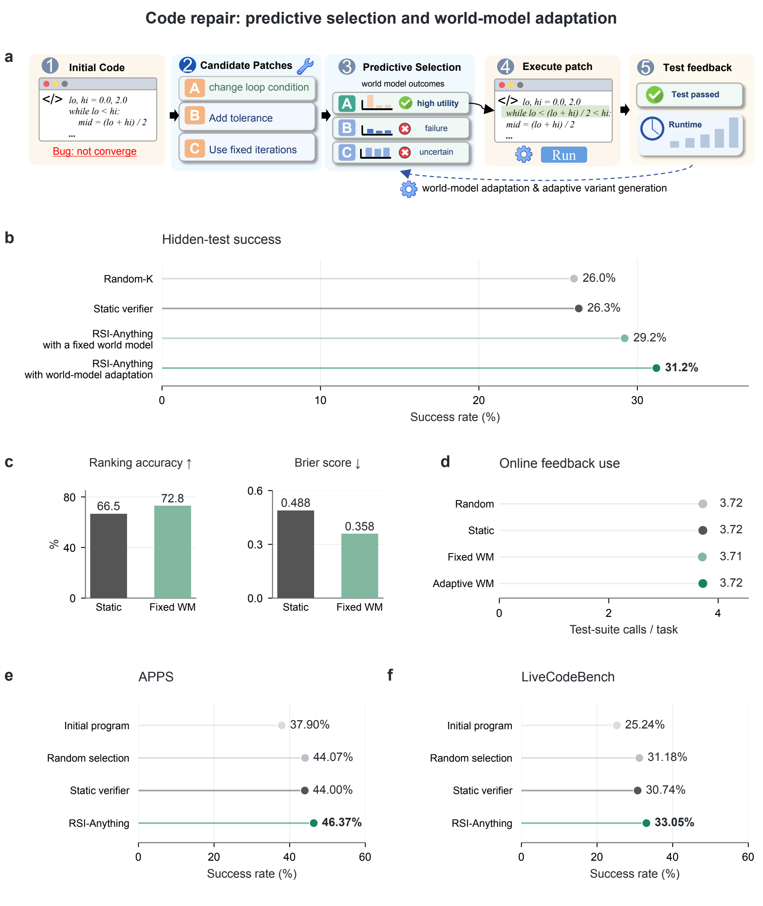

<h1 align="center">RSI-Anything</h1>

<p align="center">
  <strong>Unlocking Recursive Self-Improvement with World Models</strong>
</p>

<p align="center">预测行动后果，从交互中学习，持续改进下一轮决策。</p>

<p align="center">
  <a href="#整体框架">整体框架</a> ·
  <a href="#应用领域">应用领域</a> ·
  <a href="#实验结果">实验结果</a> ·
  <a href="#快速开始"><strong>快速开始</strong></a> ·
  <a href="#引用">引用</a> ·
  <a href="README.md">English</a>
</p>

<p align="center">
  
  <a href="https://github.com/Gen-Verse/JEPA-Anything">
  
  </a>
  
</p>

<p align="center">
  <a href="https://huggingface.co/datasets/Gen-Verse/RSI-Anything">
    
  </a>
</p>

## 项目介绍

**RSI-Anything** 是一个跨领域递归自我改进框架，将世界模型预测与真实交互反馈结合起来。它基于 **JEPA-Anything**，将候选生成、预测引导的选择、外部评价和学习连接成统一流程。

论文将这一流程应用于**代码修复、GUI 交互、实验室规划、反应优化和免疫科学**。各领域提供自己的状态、动作、预测目标和反馈来源，共同遵循提出候选、预测后果、评价所选行动、保留改进并进入下一轮的过程。

## 整体框架

<p align="center">
  <a href="docs/media/figure1-overview.png"></a>
</p>

<p align="center"><em>从 JEPA-Anything 的预测基础走向跨领域递归自我改进。</em></p>

**提出候选 → 预测后果 → 选择行动 → 执行评价 → 反馈学习 → 保留改进。** 策略或工作流提出行动，世界模型预测其后果，所选行动获得外部反馈。积累的经验支持学习与评价，保留的系统继续指导下一轮交互。

<details>
<summary><strong>展开完整流程与各领域应用</strong></summary>

<p align="center">
  <a href="docs/media/rsi-framework.pdf"></a>
</p>

整体框架将预测引导的交互与策略、科学工作流的持续改进相连接。[查看框架 PDF](docs/media/rsi-framework.pdf)。

</details>

## 应用领域

| 领域 | 任务与环境 | RSI-Anything 的作用 | Hugging Face 资源 |
| :--- | :--- | :--- | :--- |
| **代码修复** | CodeContests、APPS Introductory、LiveCodeBench | 预测程序执行结果，排序候选代码，并依据测试反馈改进解题程序。 | [资源](https://huggingface.co/datasets/Gen-Verse/RSI-Anything/tree/main/code_repair) |
| **GUI 交互** | MiniWoB++、OSWorld | 连接界面观测、动作候选和交互反馈，提高任务完成能力。 | [资源](https://huggingface.co/datasets/Gen-Verse/RSI-Anything/tree/main/gui_interaction) |
| **实验室规划** | LabHorizon F200 | 预测候选方案的质量与风险，选择符合实验协议的操作计划。 | [资源](https://huggingface.co/datasets/Gen-Verse/RSI-Anything/tree/main/laboratory_planning) |
| **反应优化** | Suzuki–Miyaura 反应筛选 | 依据产率预测选择催化剂、配体、碱和溶剂，用实测产率指导后续实验。 | [资源](https://huggingface.co/datasets/Gen-Verse/RSI-Anything/tree/main/reaction_optimization) |
| **免疫科学** | 科学 Agent 工作流与干预分析 | 连接工作流演化、免疫状态预测与自我修正，支持干预排序和前瞻性假设生成。 | [资源](https://huggingface.co/datasets/Gen-Verse/RSI-Anything/tree/main/immune_science) |

领域适配器将统一工作流连接到各任务的状态、动作空间和外部反馈。

## 实验结果

各领域实验结果；任务定义、比较设置和指标解读见[基准说明](docs/benchmarks.zh-CN.md)：

| 领域 | 评价设置 | RSI-Anything 结果 |
| :--- | :--- | :--- |
| 代码修复 | 200 道 CodeContests 题，三个种子 | 最终隐藏测试通过率 **31.2%** |
| 代码修复 | APPS Introductory，1,000 道题 | 最终完整测试通过率 **46.37%** |
| 代码修复 | LiveCodeBench v6，1,055 道题 | 最终完整测试通过率 **33.05%** |
| GUI 交互 | MiniWoB++ `click-checkboxes` | 任务成功率 **99%**，平均动作数较基线减少 **39.4%** |
| GUI 交互 | OSWorld | 相对初始 Agent 的成功率提升 **18.4%** |
| 实验室规划 | [LabHorizon F200 Level 2](tasks/laboratory_planning/README.zh-CN.md) | 规划得分 **46.01%** |
| 反应优化 | [Suzuki Flow LC–MS，100 次运行](tasks/reaction_optimization/README.zh-CN.md) | 平均最优实测产率 **96.15%**；所有运行在第 **10** 次观测以内找到候选池最高产率 |
| 免疫科学 | 端到端科学应用 | 提出结合 **SIRPα 抑制与 IL-36γ 轴调节**的候选方案，用于后续实验检验 |

### 代码修复

<p align="center">
  <a href="docs/media/figure2-code-repair.pdf"></a>
</p>

<p align="center"><em>图 2 预测引导的代码修复流程与基准对比结果。</em></p>

图中展示代码修复流程（**a**）、CodeContests 成功率、预测质量与反馈开销（**b–d**），以及 APPS Introductory 和 LiveCodeBench 结果（**e–f**）。代码策略每轮提出四个修改候选，最多运行三轮反馈修复。在线测试提供修复反馈，基准评价测试衡量最终成功率，结果取三个种子的平均值。

**APPS Introductory 与 LiveCodeBench v6** 将修复评价扩展到 1,000 道和 1,055 道题。同一道题、同一个种子下，各方法共用初始程序与 ReasonFlux-Coder-7B 策略，以公开测试指导修复，以完整官方测试集判定最终成功。三个种子的平均完整测试通过率分别达到 **46.37%** 和 **33.05%**。

[查看矢量图](docs/media/figure2-code-repair.pdf) · [基准设置](docs/benchmarks.zh-CN.md#apps-introductory-与-livecodebench) · [代码修复指南](tasks/code_repair/README.md)

### GUI 交互

<p align="center">
  <a href="tasks/gui/docs/results.png"></a>
</p>

在同一组 100 个复选框测试任务上，选定控制器在三个保留版本中分别完成 **51、79、99** 个任务。平均动作数从 **5.30 降至 3.21**，重复点击从 **237 次降至 0 次**。成功要求所有复选框状态符合指令并完成提交，限时 120 秒、最多八次动作。

**OSWorld** 将 GUI 评价扩展到桌面任务。RSI-Anything 的任务成功率较初始 Agent **相对提升 18.4%**，较 RLAnything **相对提升 5.5%**；RLAnything 较初始 Agent 相对提升 12.3%。

控制器定义、评价集合和完整统计见 [GUI 结果](tasks/gui/docs/RESULTS.md)，桌面任务比较见 [OSWorld 设置](docs/benchmarks.zh-CN.md#osworld)。

## 快速开始

### 安装统一工作流

获取仓库，使用 Python 3.10 或更高版本安装统一命令行工作流：

```bash
git clone https://github.com/Gen-Verse/RSI-Anything.git
cd RSI-Anything
python3.10 -m venv .venv
source .venv/bin/activate
python -m pip install -e .
rsi tasks
```

### 选择任务实现

| 实现 | 使用指南 | 工作流配置 |
| :--- | :--- | :--- |
| **代码修复** | [环境、资产与复现](docs/reproduction.md) | `configs/code_repair/default.json` |
| **GUI 交互** | [完整浏览器 Agent 实验](tasks/gui/README_zh.md) | `configs/gui/default.json` |
| **反应优化** | [Suzuki 条件选择与结果](tasks/reaction_optimization/README.zh-CN.md) | `tasks/reaction_optimization/infer.py` |

实验室规划见[推理指南](tasks/laboratory_planning/README.zh-CN.md)，使用 JEPA 世界模型引导候选生成与方案选择。

在 Linux 上按照任务指南准备 `.venv-code-repair` 或 `.venv-gui`，并在配置中设置运行路径和 GPU 分配，然后启动对应工作流：

```bash
# 代码修复
rsi assets code_repair --profile full --output assets
rsi plan --config configs/code_repair/default.json
rsi run --config configs/code_repair/default.json

# GUI 交互
rsi plan --config configs/gui/default.json
rsi run --config configs/gui/default.json
```

下载与离线准备见[资产指南](docs/assets.md)，阶段接口见[工作流设计](docs/workflow.md)。

<details>
<summary><strong>浏览器检查与运行管理</strong></summary>

检查浏览器环境：

```bash
python3.10 -m venv .venv-gui
.venv-gui/bin/python -m pip install -e 'tasks/gui[browser]'
.venv-gui/bin/python -m playwright install chromium
.venv/bin/rsi run --config configs/gui/smoke.json
.venv/bin/rsi report --run runs/gui-smoke
```

查看、恢复和汇总完整运行：

```bash
rsi status --run runs/gui
rsi run --config configs/gui/default.json --resume
rsi report --run runs/gui
```

</details>

## 项目结构

```text
├── src/rsi_anything/      # 统一命令行、工作流调度与任务适配器
├── tasks/
│   ├── code_repair/       # 程序执行、训练与评价
│   ├── gui/               # 浏览器交互、训练与评价
│   ├── laboratory_planning/ # 规划策略与 JEPA 世界模型推理
│   └── reaction_optimization/ # 已校准的 JEPA 引导 Suzuki 条件选择
├── configs/              # 任务配置
├── tests/                # 公共工作流检查
├── scripts/              # 资产打包与仓库校验
└── docs/                 # 图片与工作流指南
```

## 引用

如果本项目对你的研究有帮助，请引用：

```bibtex
@misc{cui2026rsianything,
  title={RSI-Anything: Unlocking Recursive Self-Improvement with World Models},
  author={Cui, Taoyong and Zeng, Pinxian and Xu, Wanghan and Xiao, Hao and Xue, Shuhan and Gao, Qiang and Ouyang, Wanli and Heng, Pheng Ann and Yin, Zhenfei and Wu, Yingcheng and Yang, Ling},
  year={2026}
}
```

## 致谢

本项目基于 [JEPA-Anything](https://github.com/Gen-Verse/JEPA-Anything)，使用 Qwen2.5-Coder 和 ReasonFlux-Coder 骨干模型以及 MiniWoB++ 浏览器任务。组件、模型和数据条款见[第三方声明](THIRD_PARTY_NOTICES.md)。

## 许可证

项目自有代码采用 [Apache-2.0](LICENSE) 许可证。
