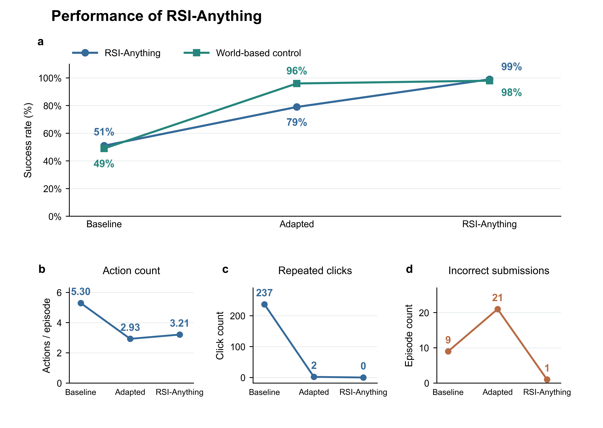

# RSI-Anything: GUI Experiment

<p>
  <a href="https://huggingface.co/datasets/Gen-Verse/RSI-Anything/tree/main/gui_interaction">
    
  </a>
</p>

Part of the RSI-Anything repository. See [repository integration](INTEGRATION.md) for environment isolation and module boundaries.

Research code for **expert-assisted GUI policy adaptation with JEPA-Anything world models** on the official MiniWoB++ `click-checkboxes` task.

The GUI workflow connects collection, world-model training, policy adaptation, controller selection, crossed evaluation, conditional confirmation and completion auditing. Source history and verification records are in [provenance](docs/PROVENANCE.md) and [verification](docs/VERIFICATION.md).

## Reported results

The agent reads a task instruction and visible DOM, clicks the requested checkboxes in Chromium, and submits the form. **Strict success** requires every checkbox to match the instruction and a completed submission, within 120 seconds and at most eight actions (including submission).

The same 100 RSI test instances are evaluated at three retained versions:

| Metric | Baseline | Adapted checkpoint | RSI-Anything |
|---|---:|---:|---:|
| Selected-controller success | 51/100 | 79/100 | **99/100** |
| World-based control success | 49/100 | 96/100 | **98/100** |
| Selected-controller mean actions per episode | 5.30 | 2.93 | 3.21 |
| Selected-controller repeated clicks, total | 237 | 2 | **0** |
| Selected-controller incorrect submissions, total | 9 | 21 | **1** |

**Baseline → Adapted checkpoint → RSI-Anything** follows the starting policy/world pair, the retained pair after one update, and the retained pair after two updates. Each update collects browser experience, adapts the policy from successful actions with replay, updates the world model using actual transitions and expert continuations, and selects the retained version on development instances. Evaluation uses frozen models.

**Selected controller** is the execution rule chosen on the development set; the reported runs select `alpha=0`, which follows policy ranking. **World-based control** uses world-model values to rank the same policy-proposed candidates, including submission. These are two evaluation modes for each model version.

The final selected controller completes **48 more tasks per 100** than the baseline. Mean actions include successful and failed episodes; repeated clicks and incorrect submissions are totals over the 100 episodes. The intermediate version's shorter episodes should be read alongside its 21 incorrect submissions.



On the separate 100-instance world-test cohort, pure OPF control changes from 52/40/44% to 95/95/96% across three fixed world models. On the 630-instance paired confirmation cohort, their mean success rises from **43.81% to 97.04%**, a gain of **53.23 percentage points** (task-paired bootstrap 95% CI **[50.26, 56.30]**). Cohort definitions, metric definitions, crossed evaluations and all control arms are in [RESULTS.md](docs/RESULTS.md).

## Run through the shared workflow

From the repository root, install the task environment alongside the common `rsi` entry point:

```bash
python3.10 -m venv .venv-gui
.venv-gui/bin/python -m pip install torch==2.5.1 --index-url https://download.pytorch.org/whl/cu121
.venv-gui/bin/python -m pip install -r tasks/gui/requirements.txt
.venv-gui/bin/python -m pip install -e 'tasks/gui[test]'
.venv-gui/bin/python -m playwright install chromium
rsi plan --config configs/gui/default.json
rsi run --config configs/gui/default.json
```

The shared runner records stage progress and the final summary. Its GUI adapter renders the native task configuration into the run directory. The task-native commands below are also available for individual operations.

## Installation

Recorded training environment: **Linux, Python 3.10.21, CUDA 12.1, PyTorch 2.5.1, Chromium 140 and A800 80 GB GPUs**. The default resource configuration schedules the five world arms sequentially and assigns three physical GPUs: persistent policy service, world training, and RSI policy training. Six GPUs allow the world arms to run concurrently. CPU-only machines can run unit tests, statistics reproduction and browser smoke tests.

Run the following from `tasks/gui/` in the integrated repository, or from the root of the standalone GUI source package:

```bash
python3.10 -m venv .venv
source .venv/bin/activate
python -m pip install --upgrade pip
python -m pip install torch==2.5.1 --index-url https://download.pytorch.org/whl/cu121
python -m pip install -r requirements.txt
python -m pip install -e '.[test]'
python -m playwright install chromium
```

On a Linux host missing browser system libraries, an administrator should install them using `python -m playwright install-deps chromium`. Normal Playwright browser lookup is used; an existing `PLAYWRIGHT_BROWSERS_PATH` override is respected. The package includes the original task HTML and dependencies at MiniWoB++ commit `33c3b4ddef8c6eb67c57a29663d844b1eda7e614`. No external task checkout is needed.

Application versions are pinned in `requirements.txt` and [original_runtime.json](docs/original_runtime.json). The browser interface can be installed independently; full training uses the dependencies above.

## Fast browser validation

No models or GPU are required. Start in the GUI directory with a separate Python 3.10 environment:

```bash
python3.10 -m venv .venv
source .venv/bin/activate
python -m pip install -e '.[browser,test]'
python -m playwright install chromium
rsi-anything-gui --config configs/full.json smoke --episodes 4
```

This executes checkbox clicks and submission in Chromium using the rule controller, then records a smoke report.

## Complete experiment

1. Copy `configs/full.json` if needed; set a **new** `run_root` and physical GPU IDs. Relative paths resolve beside the configuration file. Existing model directories can be configured using `world_model` and `policy_model`; their final directory names must match the pinned model names. `configs/parallel.json` has five parallel world workers.
2. Acquire the two external models at their recorded revisions. The downloader verifies every required static file against the original SHA256 hashes.
3. Freeze inputs and protocol; run the actual browser and GPU learning contracts; launch the scheduler.

```bash
rsi-anything-gui --config configs/full.json download-models
rsi-anything-gui --config configs/full.json doctor --gpu
rsi-anything-gui --config configs/full.json freeze
rsi-anything-gui --config configs/full.json preflight browser
rsi-anything-gui --config configs/full.json preflight world
rsi-anything-gui --config configs/full.json run
```

Models are [Qwen/Qwen2.5-Coder-3B-Instruct](https://huggingface.co/Qwen/Qwen2.5-Coder-3B-Instruct/tree/488639f1ff808d1d3d0ba301aef8c11461451ec5) and [Gen-Verse/ReasonFlux-Coder-7B](https://huggingface.co/Gen-Verse/ReasonFlux-Coder-7B/tree/6860a2fd222bd2e18e8a5b62a9c0887d2ba70c36). The `download-models` command acquires the base models under their respective licenses. Static hashes are shipped in `src/rsi_anything_gui/assets/base_inputs.json`. Use `verify-models` to validate existing local models. The complete download is approximately 22 GB; allow additional space for adapters, traces, caches and the environment.

The scheduler requires assigned GPUs to use at most 500 MiB before an owned job starts, and the policy port to be free. It performs initial and calibration collection, baselines, five world arms, two RSI proposals, conditional 630-instance confirmation, audit, and statistics. It stops its own process groups on completion, failure or interruption. It does not retry failed stages automatically. Consult `logs/pipeline_status.json` and per-job logs before restarting; committed episodes and matching checkpoints can be reused under the same frozen protocol.

After completion:

```bash
rsi-anything-gui --config configs/full.json audit
rsi-anything-gui --config configs/full.json aggregate
```

Outputs are under the configured `run_root`: `data/`, `checkpoints/`, `results/`, `logs/`, `screenshots/`, and `outputs/`. Aggregate reports require the completion audit to pass. Source, core, task assets, resource plan and resolved runtime paths are frozen before formal collection. Use a new run directory when changing the frozen configuration or inputs.

## Protocol and implementation

```text
Official browser + visible DOM
    → actual branches + expert continuations (training only)
    → online encoder / EMA target / OPF predictor + supervised heads
    → separate terminal calibration + development controller selection
    → paired world evaluation
    → successful actual-action SFT + replay, and world update (two proposals)
    → freeze both versions → crossed policy/world tests → audit → aggregate
```

- DOM text observations; strict all-checkbox correctness; 120-second timeout; at most 8 actions.
- Identical terminal-inclusive top-four policy candidate protocol for all relevant arms. Selected controllers use the development-selected `alpha=0` policy ranking; pure world control ranks those candidates by world values.
- OPF: `d=256`, `K=4`, `r=64`; trainable online LoRA encoder; EMA decay `0.996`; learned soft-Gram projectors. The vendored JEPA core is unchanged.
- World training: three joint epochs, then 100 critic-head epochs on cached predicted representations from the same training rows. Initial and update arms share training supervision.
- Positive-only successful-episode policy SFT, one epoch, at most 256 new actions plus equal successful replay.
- Separate probe, initial, update, calibration, development, diagnostic, world-test, confirmation, and RSI-test cohorts.
- Development gates select controllers and promote candidates; both RSI proposals freeze before RSI test opens.
- Statistics: 10,000 task-paired bootstrap samples, fixed three OPF models, exact McNemar tests, and Holm correction for six prespecified secondary comparisons. Cost gates use uncached-equivalent policy time plus measured world/browser time; observed shared-cache wall time is reported separately.

Module map: [ARCHITECTURE.md](docs/ARCHITECTURE.md). Exact split seeds and settings are emitted by `freeze` and documented in [PROTOCOL.md](docs/PROTOCOL.md).

## Verification and contribution

Run from the GUI directory after installing the full dependencies above. For a CPU-only check environment, use CPU PyTorch plus NumPy, SciPy and the `browser,test` extras; see the integrated repository's GUI CI workflow.

```bash
RSI_TEST_BROWSER=1 python -m pytest
python scripts/reproduce_reported_statistics.py
python scripts/verify_release.py
```

`RSI_TEST_BROWSER=1` enables the installed-Chromium tests. Tests cover source/input freezing, public-observation isolation, zero-weight controller fallback, interrupted episode recovery, successful-episode filtering, owned-process cleanup, port collision refusal, statistics and the upstream JEPA geometry/state primitives.

For changes affecting experiments, retain the original source identities, create a new run root, rerun preflight, freeze a new protocol, and report new results separately. Please see [THIRD_PARTY_NOTICES.md](THIRD_PARTY_NOTICES.md) for upstream attribution and license scope.
